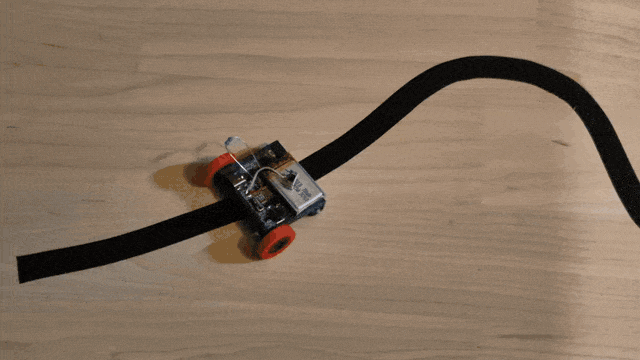
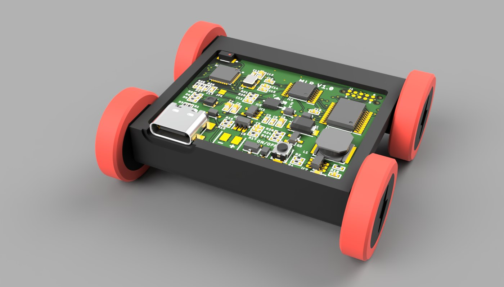
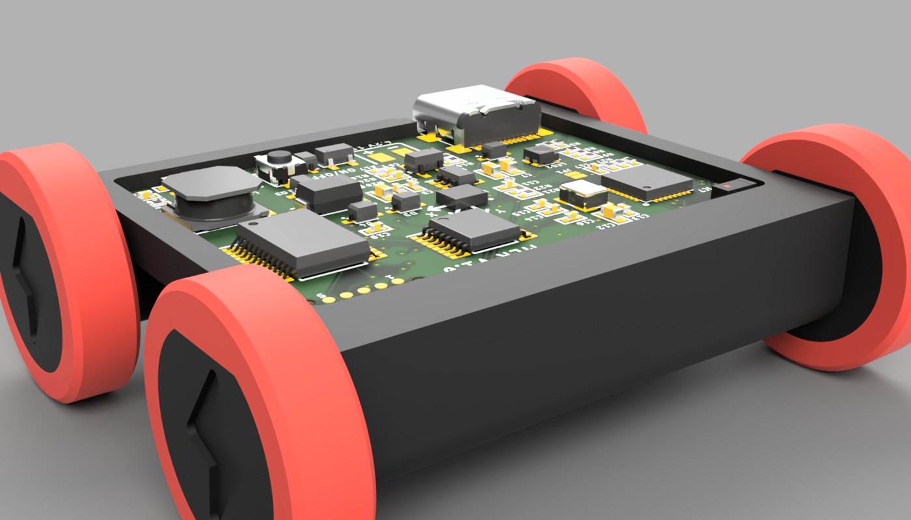
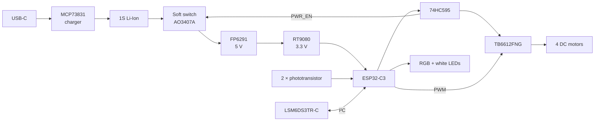
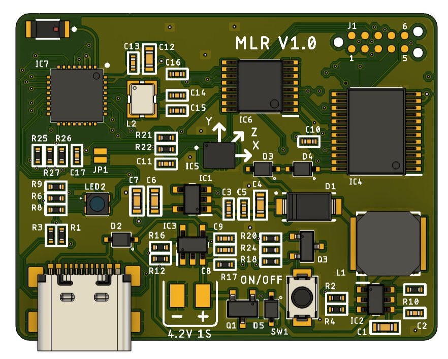
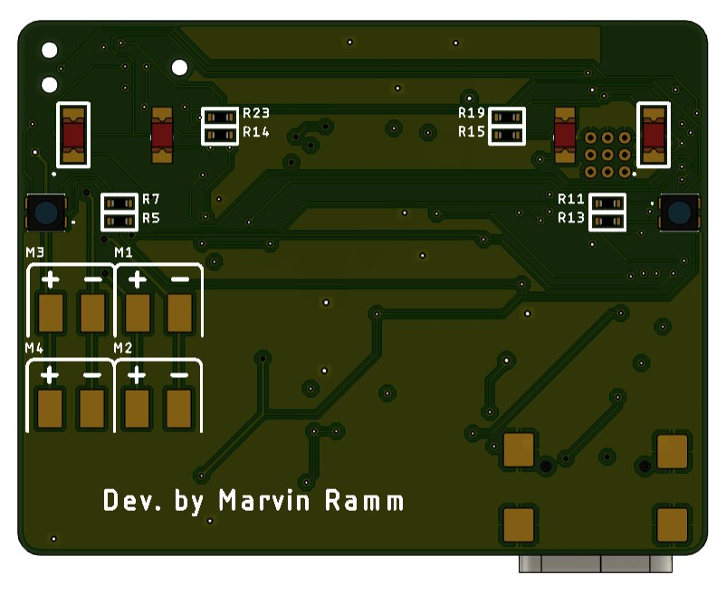

# MLR – Mini Line Follower Robot

[](LICENSE)
[](hardware/LICENSE)

**A palm-sized robot on a 40.4 × 31.3 mm board. It has an ESP32-C3, four motors, line sensors, RGB lighting, a 6-axis IMU and a 1S Li-Ion battery that charges over USB-C.**

<p align="center">
  
</p>

I developed the MLR in 2024 in a group project at HTW Berlin. In the full project, a glove controls the robot over ESP-NOW; that part is not included here. This repository contains the 4-layer board and my firmware. The goal: a robot smaller than a hand and lighter than 80 g that follows a line, detects colours and aligns itself with a gyroscope.

<p align="center">
  
  
</p>

## Features

- **ESP32-C3** (ESP32-C3FH4, 4 MB flash) with Wi-Fi and Bluetooth LE and a 2.4 GHz chip antenna
- **Four DC motors** on a TB6612FNG. The motors on each side run in pairs, so the robot steers like a tank.
- **Line sensors:** two phototransistors under the board with warm-white LEDs for illumination
- **Colour detection:** two RGB LEDs on the bottom light the floor in red or green
- **6-axis IMU** LSM6DS3TR-C for heading and tilt
- **Power:**
  - 1S Li-Ion battery
  - MCP73831 charger on USB-C, the blue status LED shows charging
  - FP6291 boost converter to 5 V for motors and LEDs, RT9080 LDO for 3.3 V
- **Soft power switch:** the button turns the robot on, and the firmware keeps it on through a P-MOSFET (`PWR_EN`). That lets the robot switch itself off.
- **74HC595 shift register** for motor direction, standby, status LED and power latch. This frees GPIOs on the small ESP32-C3.
- **Tag-Connect TC2050** footprint for programming; native USB of the ESP32-C3 on the USB-C port

## How it works



<p align="center">
  
  
</p>

## Firmware

| Sketch | Function |
|---|---|
| [`firmware/Linefollower`](firmware/Linefollower) | Follows a black line: the difference between the right and left sensor speeds up one side and slows down the other (proportional control). |
| [`firmware/KeepAngle`](firmware/KeepAngle) | Keeps the heading with the IMU and a Madgwick filter. If you turn the robot, it turns back. Tilt it to switch it off. |
| [`firmware/Charging`](firmware/Charging) | Minimal sketch for charging: motors and LEDs off. |

Build with the [ESP32 Arduino core](https://docs.espressif.com/projects/arduino-esp32/en/latest/installing.html) (tested with 2.0.17), board **ESP32C3 Dev Module**, *USB CDC On Boot: Enabled*. `KeepAngle` also needs the [FastIMU](https://github.com/LiquidCGS/FastIMU) library.

```bash
arduino-cli compile --upload -p /dev/ttyACM0 \
  --fqbn esp32:esp32:esp32c3:CDCOnBoot=cdc firmware/Linefollower
```

The ESP32-C3 is flashed directly over USB-C. If the upload does not start, close the `BOOT` solder jumper (JP1, GPIO9 to GND) while switching the robot on, then open it again.

## Hardware

| | |
|---|---|
| PCB | 4 layers, 40.4 × 31.3 mm, 1.6 mm |
| Schematic | [`hardware/mlr-v1.0/MLR-V1.0_schematic.pdf`](hardware/mlr-v1.0/MLR-V1.0_schematic.pdf) |
| BOM | [`hardware/mlr-v1.0/MLR-V1.0_BOM.csv`](hardware/mlr-v1.0/MLR-V1.0_BOM.csv) |
| Fabrication data | ODB++ in the [release](https://github.com/marvinramm/MLR-Mini-Line-Follower-Robot/releases) (most PCB manufacturers accept it directly) |

## License

© 2024 Marvin Ramm. Open source with attribution:

- Code (`firmware/`): [MIT](LICENSE)
- Hardware and documentation: [CC BY 4.0](hardware/LICENSE)

Commercial use is allowed. Credit "MLR by Marvin Ramm" with a link to this repository. Details, including the third-party Madgwick filter, are in [LICENSING.md](LICENSING.md).
